 

 

 

### About me

I build across the stack: backend APIs, full-stack web apps, AI features, and MCP tooling. I lean toward projects that get tested against real conditions, not just demoed once and shipped.

- 🧪 I test things by actually breaking them: race conditions under real concurrent load, clean-checkout runs, chasing down query-planner behavior instead of trusting the first benchmark number.
- 🛠️ Backend: FastAPI/Flask APIs, PostgreSQL. AI: LLM-powered features, Anthropic/OpenAI SDKs. MCP: building servers and tools that let models act on real systems. Full-stack: React + TypeScript. Infra: Docker, AWS (EKS, multi-tier deployments). Also comfortable in C++.
- 🎓 Software engineering student, currently exploring internship / working student opportunities.

 

### Open source

- Found and fixed two SQLite concurrency bugs in [DBOS](https://github.com/dbos-inc/dbos-transact-py/pull/943) *(merged)*: workflows sharing a concurrency budget could overspend it, and a transaction step could write-skew past a cap, both from reads running outside the write lock. Proven with deterministic concurrency tests, not timing-dependent ones.
- Licensed [DevPulse](https://github.com/ApparentlyTejas/DevPulse) into the [XERJ Corpus Hub](https://hub.xerj.org/contributors/ApparentlyTejas): an open reference library AI coding agents search before writing code, indexing a real commit (per-org rate limiting, bounded Claude request timeout/retries) as a worked example.
- Fixed a dtype-validation gap in [kornia](https://github.com/kornia/kornia/pull/6411) *(merged)*: two geometry conversion functions let integer/bool tensors through to a bare, unhelpful `RuntimeError` instead of a clear error matching their sibling functions.
- Fixed a mistagged register in Home Assistant's [solax-modbus](https://github.com/wills106/homeassistant-solax-modbus/pull/2462) *(merged)* integration: three X1 Boost G4/Smart G2 entities were tagged for the wrong hardware generation (GEN3 instead of GEN4), so Manufacturer/Model/Language never read correctly on that hardware.
- Fixed [dill](https://github.com/uqfoundation/dill/pull/818)'s *(merged)* `check()` failing on large objects: it built a subprocess command by embedding the pickled object in a shell-split string, blowing past the OS argv length limit. Switched to passing argv as a list and piping the payload over stdin instead.

 

### Tech

